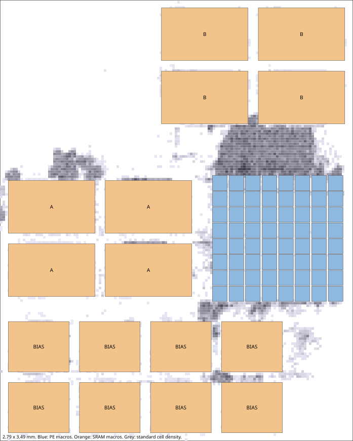
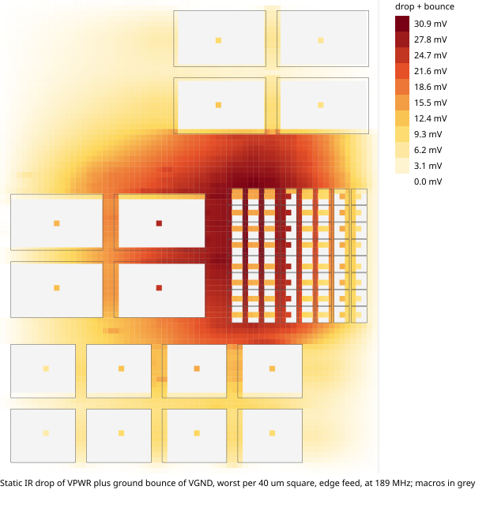

# Implementation results

Two kinds of results: an ASIC implementation on an open 130 nm process, which
is the main target, and an FPGA implementation used as a prototype.

| Flow | State |
|------|-------|
| ASIC, sky130, synthesis and pre-layout timing | done |
| ASIC, sky130, place and route of the array | done up to 16 x 16 (16 x 16 hierarchically, with the PE as a hard macro) |
| ASIC, sky130, place and route of the complete chip | done: 8 x 8 array, SRAM macros, clock gating, 9.9 mm2, 189 MHz at the slow corner |
| ASIC, sky130, sign-off checks (DRC, LVS, antenna) | done for the PE macro and the chip: all clean |
| ASIC, sky130, static IR drop of the chip | done: 32 mV worst (1.8 %) with the supply from the core edges, after a power ring and wider met5 stripes (383 mV before) |
| ASIC, sky130, power of the chip from simulated activity | done: 31 - 44 pJ per multiply-accumulate; idle 12 mW at 100 MHz with clock gating (119 mW without) |
| FPGA, Lattice ECP5 (Yosys + nextpnr) | done |
| FPGA, Xilinx Zynq-7000 (Vivado) | done |

The short version, 8 x 8 array on sky130, slow corner:

| | Plain | Carry saved every 8 bits (`ACC_SEG = 8`) | No carry chain in the PE (`MUL_CS = 1`, `ACC_SEG = 4`) |
|---|---|---|---|
| Array, placed and routed | 89 MHz, 0.81 mm2 | 121 MHz, 0.88 mm2 | **198 MHz**, 1.01 mm2 |
| 16 x 16 array, hierarchical place and route | 90 MHz, 3.67 mm2 | 121 MHz, 4.01 mm2 | **198 MHz**, 4.45 mm2 |
| Complete accelerator, synthesis only, without memories | 86 MHz, 165 kGE | 118 MHz, 173 kGE | 161 MHz, 193 kGE |

Systolic against broadcast, same datapath in both, three technologies:

| | systolic | broadcast |
|---|---|---|
| ECP5, LUT multipliers, 4 x 4 -> 12 x 12 | about 150 MHz throughout | 138 -> 99 MHz |
| Zynq-7000, 4 x 4 -> 16 x 16 | 164 -> 158 MHz | 156 -> 139 MHz |
| sky130, routed, slow corner, 4 x 4 -> 8 x 8, plain accumulator | 90 -> 89 MHz | 90 -> 90 MHz |
| sky130, routed, slow corner, 4 x 4 -> 8 x 8, `ACC_SEG = 8` | 122 -> 121 MHz | 118 -> 115 MHz |
| sky130, routed, slow corner, 4 x 4 -> 8 x 8, `MUL_CS = 1` | 194 -> 198 MHz | 182 -> 165 MHz |
| sky130, slow corner, 16 x 16, `MUL_CS = 1` | 198 MHz (hierarchical, routed) | 129 MHz (reduced flow, estimate) |

The more of the critical path is wire, the more the neighbour-only wiring is
worth. On the FPGAs routing is over half of it; on the ASIC the difference
only appears once the accumulator adder no longer hides it.

# ASIC: SkyWater sky130, synthesis

Flow: `syn/asic/run.py`, numbers in `syn/asic/results.csv`. Yosys maps the RTL
to the `sky130_fd_sc_hd` standard-cell library, OpenSTA analyses timing.

* Corners: typical (tt, 25 C, 1.80 V) and slow (ss, 100 C, 1.60 V).
* Frequencies are for the worst register-to-register path. The logic is mapped
  for a 5 ns clock, the variants with saved carries for 4 ns, those with the
  carry-save multiplier for 3 ns.
* **These are pre-layout numbers.** No wire delay, no clock tree, no hold
  fixing. The array has been placed and routed, see the next part; the
  complete accelerator has not.
* The operand memories are SRAM macros in an ASIC. They are black boxes here
  and not part of any area figure.
* 1 gate equivalent (GE) = one `nand2_1` = 3.75 um2.
* The multiply-accumulate datapath of the PE (`gemm_mac`) is synthesised once
  and the same netlist is used in every design below, including the broadcast
  baseline. Mapped separately in each design, identical RTL came out up to 7 %
  apart in speed.

## Complete accelerator, 8 x 8 array

`gemm_top` without the memories:

| | Area | Flip-flops | Fmax typical / slow |
|---|---|---:|---|
| default parameters | 168 kGE (628 600 um2) | 10 178 | 164 / 86 MHz |
| `ACC_SEG = 8` | 173 kGE | 11 038 | 227 / 118 MHz |
| `MUL_CS = 1`, `ACC_SEG = 4` | 193 kGE | 12 802 | 339 / 161 MHz |

The two options are explained below. In all three the array is what limits
the frequency now (see [the control logic](#the-control-logic-around-the-array)).
Peak throughput is 64 multiply-accumulates per cycle: 5.5, 7.6 and
10.3 GMAC/s at the slow corner.

Where the area goes (default parameters; cells of each module type, not
counting its submodules):

| Module | Instances | Area (um2) | Share |
|--------|----------:|-----------:|------:|
| `gemm_mac` (PE datapath) | 64 | 369 280 | 58.8 % |
| `gemm_fifo` (output FIFO) | 1 | 116 000 | 18.5 % |
| `gemm_delay` (skew and de-skew) | 41 | 54 841 | 8.7 % |
| `gemm_pe` (PE forwarding registers) | 64 | 27 066 | 4.3 % |
| `gemm_core` (input register, glue) | 1 | 17 700 | 2.8 % |
| `gemm_tile_iter` | 4 | 15 600 | 2.5 % |
| `gemm_csr` | 1 | 7 300 | 1.2 % |
| `gemm_load` with its two `gemm_dcnt` counters | 1 | 9 310 | 1.5 % |
| `gemm_seq` | 1 | 4 600 | 0.7 % |
| `gemm_ctrl` | 1 | 4 280 | 0.7 % |
| `gemm_out` | 1 | 2 490 | 0.4 % |

Three things stand out:

* **The output FIFO is 18 % of the logic.** It holds 8 rows of 257 bits in
  flip-flops, and a copy of the oldest row in a register of its own (see
  below). `OUT_DEPTH` is a parameter and the design is correct for any
  depth from 1, so this is a direct area / throughput trade.
* **The skew and de-skew lines are 9 %.** They are 2540 flip-flops, more than
  half as many as the array has, but the array's area is dominated by its
  multipliers and adders.
* **Operand and control forwarding is 4 %**, or 6.6 % of a PE. This is what
  the systolic structure costs in logic area.

Memories that would be SRAM macros: A and B are 1024 x 64 bit each, bias is
64 x 256 bit.

## One processing element

| `PE_PIPE` | Area | Flip-flops | of which datapath (`gemm_mac`) |
|-----------|------|-----------:|--------------------------------|
| 1 | 6173 um2 = 1.6 kGE | 66 | 5768 um2, 48 flip-flops |
| 0 | 6048 um2 = 1.6 kGE | 50 | 5643 um2, 32 flip-flops |

About a quarter of a PE is flip-flops; the rest is the 8 x 8 Booth multiplier,
the 32-bit accumulator adder and the load multiplexer.

## Array size, pipelining and adder architecture

Plain accumulator (`ACC_SEG = 0`):

| Design | Area (kGE) | Flip-flops | Fmax typical (MHz) | Fmax slow (MHz) |
|--------|-----------:|-----------:|-------------------:|----------------:|
| systolic 4 x 4 | 26.3 | 1056 | 163 | 85 |
| systolic 8 x 8 | 105.3 | 4224 | 163 | 85 |
| systolic 16 x 16 | 421.0 | 16 896 | 163 | 85 |
| broadcast 4 x 4 | 25.0 | 836 | 163 | 85 |
| broadcast 8 x 8 | 99.1 | 3204 | 161 | 84 |
| broadcast 16 x 16 | 394.9 | 12 548 | 48 | 27 |
| systolic 8 x 8, `PE_PIPE = 0` | 103.1 | 3200 | 139 | 72 |
| systolic 8 x 8, ripple-carry adder | 103.6 | 4224 | 146 | 75 |
| `gemm_core` 8 x 8 | 149.4 | 9299 | 164 | 86 |

* **The accumulate stage is the critical path**, not the multiplier: product
  register -> 32-bit adder -> load multiplexer -> accumulator. The default flow
  therefore maps carry chains to a Sklansky prefix adder, which is 12 % faster
  than ripple carry for 2 % more area.
* **The product register is worth 17 %** (139 -> 163 MHz typical, 72 -> 85 MHz
  slow), for 2 % more area.
* **Systolic against broadcast.** Before layout the systolic array has the
  same frequency at every size, as it should: every PE is the same netlist and
  there are no wires. The broadcast baseline matches it up to 8 x 8, because
  both are limited by the same path inside the datapath. Its 16 x 16 number is
  not meaningful: logic synthesis does not buffer nets, and here one flip-flop
  drives 16 multipliers and the valid and shift registers drive 256 PEs each.
  Buffering is done during place and route. The baseline is 5 - 6 % smaller.

## Saved carries in the accumulator

Since the accumulate stage limits the clock, the next step is to take the
carry propagation out of it. `ACC_SEG = n` cuts the 32-bit adder into n-bit
segments. The carry out of a segment is not passed to the next segment in the
same cycle; it is saved in a flip-flop and added there one cycle later. The
accumulated value is then the stored sum plus a few saved carries. They travel
along the shift chain with the sum and are added in once, by a pipelined adder
per column at the north edge of the array (`gemm_cpa`). `ACC_SEG = 1` is the
textbook carry-save accumulator: one full adder per bit and a saved carry per
bit.

| `ACC_SEG` | Datapath (um2) | Flip-flops per PE | Accumulate stage alone, typical / slow (MHz) | 8 x 8 array (kGE) | 8 x 8 array, typical / slow (MHz) |
|-----------|---------------:|------------------:|----------------------------------------------|------------------:|-----------------------------------|
| 0 (plain) | 5768 | 66 | 163 / 85 | 105.3 | 163 / 85 |
| 16 | 5826 | 67 | 242 / 123 | 113.6 | 227 / 118 |
| 8 | 5858 | 69 | 285 / 143 | 114.1 | 227 / 118 |
| 4 | 6091 | 73 | 374 / 192 | 118.1 | 227 / 118 |
| 1 (carry-save) | 6848 | 97 | 493 / 252 | 131.0 | 227 / 118 |

* **One saved carry is enough.** With any setting the array runs at 227 / 118
  MHz, because the multiply stage (operand register -> multiplier -> product
  register) is then the critical path. Cutting the adder further only adds
  flip-flops: the full carry-save form costs 19 % more datapath area for no
  gain.
* **The default for the faster variant is `ACC_SEG = 8`.** It leaves the
  accumulate stage 20 % faster than the multiply stage, for three flip-flops
  per PE (1.6 % of the datapath).
* **What it costs.** The 8 x 8 array grows by 8 %: 1.6 % in the PEs and the
  rest in the eight final adders, which are generic 32-bit adders in two
  pipeline stages (3311 um2 each). Their share halves with every doubling of
  the array (16 x 16: + 5 %). Results leave the array two cycles later; the
  tile period is unchanged.
* **Frequency: + 39 %** before layout, for the array.

## A multiplier without a final adder

With the accumulator out of the way the multiply stage is the critical path,
and a multiplier ends in a carry-propagate adder too: the partial products
are reduced to two rows by a tree of 3:2 compressors, and the two rows are
added. `MUL_CS = 1` selects a datapath (`gemm_mac_cs`) that leaves that
addition out. The two rows are registered as they are and merged with the
accumulator by one more layer of full adders in the accumulate stage; what is
left to add there is two rows again, and that goes through the segmented
adder with saved carries. A PE then has no carry chain longer than `ACC_SEG`
bits.

The multiplier is written out for this: Baugh-Wooley partial products (the
terms with exactly one sign bit inverted, a constant to make up for it), four
levels of 3:2 compressors for 8 x 8 bits, and a correction of the top bit of
the two rows that gives them the right sign extension without knowing the
sign of their sum.

8 x 8 systolic array:

| `MUL_CS` | `ACC_SEG` | Flip-flops per PE | Datapath (um2) | Accumulate stage alone, slow (MHz) | Array (kGE) | Array, typical / slow (MHz) |
|----------|-----------|------------------:|---------------:|-----------------------------------:|------------:|-----------------------------|
| 0 | 0 | 66 | 5768 | 85 | 105.3 | 163 / 85 |
| 0 | 8 | 69 | 5858 | 143 | 114.1 | 227 / 118 |
| 1 | 8 | 80 | 6451 | 158 | 128.6 | 349 / 161 |
| 1 | 4 | 84 | 6659 | 179 | 132.2 | 340 / 162 |
| 1 | 2 | 92 | 6990 | 210 | 137.8 | 346 / 159 |
| 1 | 1 | 108 | 7493 | 203 | 146.4 | 367 / 176 |

* **The multiply stage drops from 8.5 to 5.9 ns** at the slow corner, and the
  array from 118 to 162 MHz. Against the plain design that is 1.9 times the
  frequency for 1.26 times the area.
* **`ACC_SEG = 4` is used with it.** The accumulate stage has an extra layer
  of full adders now, so 8-bit segments leave it level with the multiply
  stage; 4-bit segments leave 10 % of margin.
* **The final adders had to follow.** After routing, the critical path of the
  systolic array was in the adders at the north edge, which added 16 bits per
  cycle. They add 8 bits per cycle in this variant (`CPA_SEG = 8`), and
  results leave the array four cycles after the shift instead of two.
* **Cost per PE**: 18 more flip-flops than the plain PE (the second row of
  the product, the saved carries) and 15 % more datapath area.

## The control logic around the array

Every time the array became faster, the complete accelerator stopped at a
path outside it. Slow corner, before layout:

| | Array | Complete accelerator | What limited the accelerator |
|---|---|---|---|
| plain, first version | 85 MHz | 80 MHz | tile iterator: comparators on the remaining counts |
| plain | 85 MHz | 86 MHz | the array |
| `ACC_SEG = 8`, before | 118 MHz | 107 MHz | tile controller |
| `MUL_CS = 1`, `ACC_SEG = 4`, before | 162 MHz | 125 MHz | 16-bit counter of the loader |
| `ACC_SEG = 8`, now | 118 MHz | **118 MHz** | the array |
| `MUL_CS = 1`, `ACC_SEG = 4`, now | 162 MHz | **161 MHz** | the array |

The 125 MHz were not one path but eleven groups of paths slower than the
array: counters, comparators and handshakes in the loader, the output FIFO
and output stream, the controller, the sequencer, the CSR block. Two causes,
in about equal parts.

**The technology mapping built ripple chains.** A 16-bit decrement took 6.5 ns
at the slow corner as a chain of eight OR gates, although synthesis maps every
adder as a Sklansky prefix tree. Yosys' default ABC script restructures for
area before it maps for delay, and the area rewriting collapses the shared
prefix tree into a chain. The control logic (jobs `core_8*`, `top_8*`) is now
mapped with an ABC script that adds SOP balancing and delay-oriented
resynthesis (`ABC_DELAY` in `syn/asic/run.py`): the loader alone went from
7.6 to 6.1 ns, the accelerator from 125 to 138 MHz, for 2 % more area. The
datapath is synthesised as before (it is in hard modules, see above).

**Decisions were computed in the cycle that needed them.** "Is this the last
row of the tile?" was a comparison of a counter with the tile size, which was
itself selected from a remaining count; its result decided whether a tile
iterator advanced, and the iterator's update logic was behind it; the
handshake that started this came from another block. The changes all follow
one rule: a decision used in a cycle is a register, worked out the cycle
before, and a signal that arrives late (a handshake from another block) only
chooses between values that are ready.

| Step | `MUL_CS` accelerator |
|------|----------------------|
| start | 125 MHz |
| delay-oriented mapping of the control logic | 138 MHz |
| tile iterator: tile size and size - 1 as registers; output FIFO with a registered head | 121 MHz |
| controller: beat decisions (`need_d`, `need_credit`, last row, last K, credit) as registered flags | 138 MHz |
| tile iterator: the first tile of a matrix and of a band worked out from the dimensions a cycle ahead | 146 MHz |
| loader: split down-counters (`gemm_dcnt`) instead of 16-bit decrements | 142 MHz |
| ... restarting from registers that hold the count already split | 152 MHz |
| sequencer: the bias iterator started without gating the start pulse | **161 MHz** |

The third step made things worse, and it shows how these paths are built:
the iterator then had more registers to switch when the handshake arrived,
and the handshake of the bias stream still came out of the controller's
comparators. Only with the controller's decisions registered did both
changes pay.

The pieces:

* `gemm_tile_iter` keeps the size of the current tile and the size minus one
  in registers, so a stream finds the end of a tile with a 4-bit equality,
  and it works out the first tile of the matrix and of a band from `m_i` and
  `n_i` one cycle ahead (the CSR block writes them in an earlier register
  access and locks them while busy).
* `gemm_fifo` has its oldest entry in a register and the next one selected
  ahead of time, so a pop only chooses between them; `valid_o` is a register
  too. Capacity and latency are unchanged. This is the largest addition: 257
  flip-flops.
* `gemm_ctrl` is written as next-state logic, and the decisions for the next
  beat are computed from the next state.
* `gemm_dcnt` is a down-counter for counts whose value nobody reads, only the
  end (elements left in a row, rows left in a matrix): two halves with half
  the borrow chain each, the high half kept as "high half - 1", flags for
  "low half 0", "high half 0" and "value 1" computed one decrement ahead. It
  has its own test (`tb/test_gemm_dcnt.py`) up to the largest value, because
  the array and top-level tests never count beyond 256; `test_gemm_top` got
  rows of 300 and 260 elements as well.

Cost: 6 % more area for the complete accelerator (628 600 against
590 300 um2 with the plain datapath), about half of it the FIFO head
register.
Excluding 4-input OR cells from the mapping, tried as well, gave 2 % and was
left out: that is within the run-to-run spread of the mapping.

On the ECP5 the changes take the control logic off the critical path, which
was between the controller and the bias stream there too, but the design
does not get faster: the worst paths are now spread over the bias memory
output, the skew lines and the CSR block, and with 6 % more LUTs the placement
is worse on average. Over eight seeds: 112 - 141 MHz (median 127) against
128 - 146 MHz (median 137) before. Cycle counts are unchanged (the same 1469
cycles for the run measured below). The Zynq-7000 numbers below are for the
previous RTL.

## Gate-level simulation

`syn/asic/gls.py` runs the array testbench (`tb/test_gemm_array.py`, the one
that checks the RTL) on the synthesised netlists with the functional sky130
cell models. Passing: 4 x 4 and 8 x 8, plain, with `ACC_SEG = 8` and with
`MUL_CS = 1`, `ACC_SEG = 4`; 4 x 4 with `ACC_SEG = 1` and `16`; 8 x 8 without
product register and with the ripple-carry adder.

Two things had to be handled that RTL simulation hides: inputs that change on
the clock edge race the clock in a zero-delay netlist, so the netlist is
wrapped and its inputs delayed by 100 ps; and with `PE_PIPE = 0` the array has
a combinational path from `shift_i` to `c_valid_o[0]`, so outputs are sampled
after that delay.

# ASIC: SkyWater sky130, place and route of the array

Flow: `syn/asic/pnr.py` and `syn/asic/pnr.tcl` (OpenROAD), numbers in
`syn/asic/pnr_results.csv`. The synthesised netlist is floorplanned at 50 %
utilisation with pins on the side their data comes from, given a power grid,
placed, given a clock tree, repaired for setup and hold, routed, and timed at
three corners: typical, slow, and fast (ff, -40 C, 1.95 V).

Three flows, because the full one does not scale to the largest array on the
machine used:

* **Full**: timing-driven placement, detailed routing, parasitics extracted
  from the routed layout. One PE, 4 x 4, 8 x 8.
* **Reduced**: placement for wire length, buffering by electrical rules only,
  timing from the wire estimates of global routing. 8 x 8 (for calibration
  against the full flow) and 16 x 16.
* **Hierarchical**: the PE placed, routed and extracted once as a hard macro,
  the array built from copies of it, then a flat timing analysis of the whole
  with every netlist and every extracted wire. Systolic 8 x 8 and 16 x 16,
  see [below](#hierarchical-flow-the-pe-as-a-hard-macro).

Three variants of the datapath: plain, `ACC_SEG = 8`, and `MUL_CS = 1` with
`ACC_SEG = 4`. Frequencies are for the worst register-to-register path. The
clock target is one the slow corner misses: 10, 7 and 5 ns for the three
variants. Hold is repaired with a margin of 0.1 ns.

## Full flow

| Block | Die (um) | Cell area (um2) | Fmax typical / slow / fast (MHz) | Worst hold slack (ns) | Wire (mm) | DRC |
|-------|----------|----------------:|----------------------------------|----------------------:|----------:|----:|
| **plain** | | | | | | |
| systolic 4 x 4 | 456 x 456 | 113 377 | 171 / 90 / 273 | 0.22 | 290 | 0 |
| broadcast 4 x 4 | 444 x 444 | 106 580 | 171 / 90 / 273 | 0.28 | 291 | 0 |
| systolic 8 x 8 | 900 x 900 | 446 979 | 169 / 89 / 270 | 0.21 | 1144 | 0 |
| broadcast 8 x 8 | 874 x 874 | 422 788 | 170 / 90 / 272 | 0.28 | 1204 | 0 |
| **`ACC_SEG = 8`** | | | | | | |
| systolic 4 x 4 | 488 x 488 | 130 620 | 228 / 122 / 357 | 0.20 | 315 | 0 |
| broadcast 4 x 4 | 478 x 478 | 126 297 | 222 / 118 / 351 | 0.20 | 320 | 0 |
| systolic 8 x 8 | 937 x 937 | 496 041 | 227 / 121 / 357 | 0.10 | 1283 | 0 |
| broadcast 8 x 8 | 911 x 911 | 472 638 | 219 / 115 / 342 | 0.10 | 1277 | 0 |
| **`MUL_CS = 1`, `ACC_SEG = 4`** | | | | | | |
| systolic 4 x 4 | 531 x 531 | 158 658 | 392 / 194 / 633 | 0.11 | 379 | 0 |
| broadcast 4 x 4 | 521 x 521 | 157 721 | 366 / 182 / 587 | 0.11 | 386 | 0 |
| systolic 8 x 8 | 1007 x 1007 | 570 323 | **392 / 198 / 620** | 0.13 | 1469 | 0 |
| broadcast 8 x 8 | 984 x 984 | 553 396 | 326 / 165 / 519 | 0.12 | 1556 | 0 |

One plain PE on its own is 122 x 122 um.

**The routed 8 x 8 systolic array, from the plain datapath to the one without
carry chains: 169 / 89 MHz -> 227 / 121 MHz -> 392 / 198 MHz, on 0.81 -> 0.88
-> 1.01 mm2.** That is 2.2 times the frequency at the slow corner for 1.25
times the die area.

Cell area includes the clock tree, the buffers and the cells that timing
repair made larger, which is why it is above the synthesis figure. Routed
frequencies are above the pre-layout ones for the same reason: timing repair
sizes up the cells on the critical path by more than the wires cost.

All blocks are free of routing violations and meet hold at every corner. The
routed 4 x 4 and 8 x 8 systolic arrays of all three variants pass the array
testbench in gate-level simulation (`syn/asic/gls.py --pnr`), with clock
tree, buffers and resized cells in place. This DRC is the router's own; the
foundry's DRC and LVS were run for the PE macro and the chip only (see
[Sign-off checks](#asic-sign-off-checks)).

Hold needs more attention as the datapath gets faster and the shift chain
wider. The plain arrays needed no hold buffers, the 8 x 8 systolic array with
`ACC_SEG = 8` has 149, and the one with `MUL_CS = 1` has 1141 in the routed
netlist (the repair log of that run reports 754). Most of them are not where
one would expect, between neighbouring PEs: 911 of the 1141, and all 149, are
on paths from the inputs of the block. The constraints launch the inputs at
the ideal clock edge, while the registers they reach see the clock only after
the clock tree, a nanosecond or more later at the slow corner; the buffers
make up the difference. That is an artefact of constraining the array on its
own (see the hierarchical flow below, which leaves these paths to
integration). The worst hold slack is at the slow corner, not the fast one:
the clock tree and its skew scale with the corner too. A first run of this
variant without the margin missed hold on two blocks, by 2 and 19 ps, after
routing had moved the wire delays away from the estimates that hold repair
had worked on.

## Reduced flow

Fmax typical / slow (MHz):

| Block | Plain | `ACC_SEG = 8` | `MUL_CS = 1`, `ACC_SEG = 4` |
|-------|-------|----------------|------------------------------|
| systolic 8 x 8 | 158 / 83 | 217 / 115 | 369 / 183 |
| broadcast 8 x 8 | 157 / 83 | 195 / 103 | 286 / 149 |
| systolic 16 x 16 | 156 / 82 | 215 / 114 | 343 / 174 |
| broadcast 16 x 16 | 153 / 78 | 170 / 91 | 241 / 129 |

How far to trust this flow: at 8 x 8, where both flows were run, it is 5 - 8 %
pessimistic for the systolic array and 8 - 10 % for the baseline, so it
overstates the gap between the two by a few per cent: the broadcast nets need
buffering that follows timing, and this flow only buffers for electrical
rules. The 16 x 16 baseline numbers are the softest in this document.

## Hierarchical flow: the PE as a hard macro

Flow: `syn/asic/pnr.py` with `syn/asic/pnr.tcl` (macro mode), `etm.tcl`,
`pnr_hier.tcl` and `sta_flat.tcl`; how it works is in
[syn/README.md](../syn/README.md#hierarchical-flow). The PE is placed, routed
and extracted once, with its pins on matching tracks of opposite edges, and
described to the top level by an abstract and three timing models. The top
level places N x N copies on a grid with narrow channels between them, the
final adders in a strip to the north, and routes the rest. All numbers below
come from a flat timing analysis at the end: the routed netlists of top level
and macro and the extracted parasitics of both, read once per PE (256 times at
16 x 16), without the timing models.

Fmax typical / slow / fast (MHz), systolic arrays:

| Variant | 8 x 8 full flow | 8 x 8 hierarchical | 16 x 16 hierarchical | 16 x 16 reduced flow |
|---------|-----------------|--------------------|----------------------|----------------------|
| plain | 169 / 89 / 270 | 170 / 90 / 271 | **170 / 90 / 271** | 156 / 82 |
| `ACC_SEG = 8` | 227 / 121 / 357 | 226 / 120 / 357 | **226 / 121 / 355** | 215 / 114 |
| `MUL_CS = 1`, `ACC_SEG = 4` | 392 / 198 / 620 | 397 / 199 / 628 | **390 / 198 / 615** | 343 / 174 |

Die (mm2), run time (s):

| Variant | 8 x 8 full flow | 8 x 8 hierarchical | 16 x 16 hierarchical | 16 x 16 reduced flow |
|---------|-----------------|--------------------|----------------------|----------------------|
| plain | 0.81, 1787 | 0.94 (+ 16 %), 48 | 3.67 (+ 15 %), 164 | 3.20, 436 |
| `ACC_SEG = 8` | 0.88, 3379 | 1.05 (+ 20 %), 93 | 4.01 (+ 19 %), 249 | 3.36, 475 |
| `MUL_CS = 1`, `ACC_SEG = 4` | 1.01, 3656 | 1.18 (+ 16 %), 105 | 4.45 (+ 16 %), 307 | 3.84, 802 |

Run times are for the top level including the flat analysis; the macro takes
another 1.5 - 2.5 minutes, once. All hierarchical blocks are free of routing violations, have every
instance connected to both power nets (`check_power_grid`), and meet hold
between registers at all corners (worst 0.16 - 0.32 ns). The routed 8 x 8
arrays of all three variants and the 16 x 16 array with `MUL_CS = 1`,
top-level netlist together with the macro netlist, pass the array testbench
in gate-level simulation (`syn/asic/gls.py --hier`).

**A 16 x 16 array is as fast as an 8 x 8 one, now measured on a routed and
extracted layout: 198 MHz at the slow corner with `MUL_CS = 1`.** The reduced
flow had estimated 174 MHz; it was 6 - 12 % pessimistic at 16 x 16, more than
the 5 - 8 % measured at 8 x 8. The critical path is the same in every array:
the forwarding register of one PE, the channel, the multiplier of the next.

**The hierarchical result matches the flat one at 8 x 8**, within 1 %, in all
three variants, at about a thirty-fifth of the run time.

**What hierarchy costs is area: 15 - 20 % more die.** Per PE, the 8 x 8
`MUL_CS` array spends 130.6 x 125.1 um (16 346 um2) where the flat one spends
15 850 um2. The macro keeps its cells 2.8 um from its edge, where the pins
are, and the channels between macros are 13.8 um (30 sites) and 5.4 um
(2 rows) wide. Standard cell area is 5 - 20 % higher as well: each macro
repairs hold on its own inputs and closes timing against fixed budgets instead
of trading slack with its neighbours. A first version with twice the margin
and channels twice as high cost 31 %. Narrower vertical channels (20 and 26
sites) left no room for the 16x clock buffers between the tap cells.

The timing models were close: through them the top level saw 198 / 196 MHz
for the `MUL_CS` arrays and 118 MHz for `ACC_SEG = 8`, against 199 / 198 and
120 / 121 MHz in the flat analysis.

Things the flow needed that the flat flow did not, each found when a number
did not add up:

* **Budgets.** A path from one PE to the next starts at a register in one
  macro and ends behind the multiplier of the other, so each macro is told how
  much of the period lies outside it: 30 % before an input, 70 % after an
  output. The output side is larger because the clock tree inside the macro
  delays the launch (0.76 ns at the slow corner). With a first, arbitrary
  split of 20 / 20 % each macro met its own constraints and the two together
  were 0.36 ns too long.
* **Hold as a contract between neighbours.** Every output stays unchanged for
  0.3 ns after the clock edge, every input tolerates a change that early, so
  each macro repairs hold on its own short input paths (`b_i` to the
  register that forwards it). Left to the top level, the delay buffers had to
  go on the wire to `b_i` as a whole, in front of the multiplier as well: 779
  of them, and setup got worse. With the contract the top level needs none.
  The `ACC_SEG = 8` macro misses the contract by 0.22 ns at the slow corner:
  hold repair stopped after 8 buffers, on inputs that also feed the
  multiplier, whose setup fails at this variant's target. The arrays built
  from it meet hold, because a real neighbour changes its outputs a
  nanosecond after the edge at that corner, not 0.3 ns.
* **Timing models one corner at a time.** OpenROAD 26Q3's
  `write_timing_model -scene` with three corners defined wrote the same
  clock-to-output arcs for all three, 1.40 ns, where the flat analysis of the
  macro gives 0.52 ns at the fast corner. OpenSTA with one corner per run
  gives the right numbers.
* **The clock edge the macro gets.** Characterised with an ideal clock, the
  model's clock tree inside the macro was 0.15 ns faster than the real one,
  which is driven through the top-level clock tree with a 0.35 ns edge. Paths
  between macros do not see this (launch and capture shift alike); a path
  from a block input does, and the flat analysis found it 0.18 ns short of
  hold where the model said it was met. The macro is now characterised with
  a 0.5 ns clock edge.
* **The abstract.** By default the routed shapes are bloated and merged; the
  merged met2 obstruction then covered part of the pins on the north edge and
  the router found no access to them. Without bloating the abstract has
  43 000 rectangles and detailed routing of the top level was about 50 times
  slower. With every layer up to met4 obstructed as a whole it routes in a
  minute.
* **Pins per row and column.** Pins are placed before the cells, and the
  output pins of a column first ended up hundreds of um away from it. The
  final adder of that column was pulled apart between them and the macros,
  with a 2 ns wire inside it: 129 MHz at 16 x 16. Each row and column now has
  its pins next to it.
* **Hold from the block inputs is left open.** At 16 x 16 the clock reaches
  the registers 1 - 2 ns after the ideal edge the inputs are constrained to,
  and closing that took over 3000 delay buffers before the repair gave up.
  It is the same artefact as in the flat flow above, and it belongs to
  integration, where the registers that drive the array are known. The top
  level carries a false path for it; `hold_in_ns` in the table reports it
  (down to -1.3 ns at 16 x 16 with `MUL_CS`).

The broadcast baseline has not been run through this flow: its operand and
control nets cross the whole array, so its PEs are not self-contained in the
same way, and a macro version would need wide routing channels for the
broadcast buses. The 16 x 16 comparison below is still between two
reduced-flow numbers.

## Systolic against broadcast

Both arrays are built from the same datapath netlist; what differs is how
operands and control reach the PEs. Slow-corner frequency of the baseline
relative to the systolic array:

| Size | Flow | Plain | `ACC_SEG = 8` | `MUL_CS = 1`, `ACC_SEG = 4` |
|------|------|-------|----------------|------------------------------|
| 4 x 4 | full | equal | - 3 % | - 6 % |
| 8 x 8 | full | equal (+ 1 %) | - 5 % | - 17 % |
| 8 x 8 | reduced | equal | - 10 % | - 19 % |
| 16 x 16 | reduced | - 5 % | - 20 % | - 26 % |

Read along a row, the table says: the shorter the logic in the PE, the more
the broadcast wires cost. Read down a column: the larger the array, the more
they cost.

**With the plain accumulator the two are equally fast up to 8 x 8**, and the
baseline is 5 - 6 % smaller.

* In both, the critical path is inside the datapath: product register ->
  32-bit adder -> load multiplexer -> accumulator. How the operands reach the
  PE does not enter into it.
* The two pipeline stages of the PE are not balanced. Before layout the
  multiply stage takes about 10 ns at the slow corner and the accumulate stage
  11.5 ns. Broadcast wires are in the multiply stage, so the baseline has more
  than a nanosecond of wire and buffer delay to spend before it is slower at
  all. At 16 x 16 that margin is used up.
* The baseline pays in wire and buffers instead: routed, it needs 5 % more
  wire at 8 x 8, and in the reduced flow several times as many buffers.

**Once the carry chains are out of the PE, the multiply stage is the critical
path of both, and the baseline falls behind as the array grows.**

* Systolic: forwarding register of the neighbouring PE -> partial products
  and compressor tree -> row registers. The path is the same in every PE of
  every array, and with `MUL_CS = 1` the routed frequency is 194 MHz at 4 x 4
  and 198 MHz at 8 x 8.
* Baseline: edge register -> buffers and wire across the array -> the same
  logic. 182 MHz at 4 x 4, 165 MHz at 8 x 8.
* The systolic array misses its 5 ns target by 1 % at 8 x 8, the baseline by
  21 %. The baseline is the smaller of the two by 5 % in die area and 3 % in
  cells, and needs 6 % more wire.

The comparison only shows a difference once the pipeline is balanced. In the
plain design the adder hid it. The FPGA results below say the same thing from
the other side: there routing is more than half of every path from the start,
and the systolic array is ahead from the start.

What the systolic array costs, all told: 6.6 % of the plain PE area for
forwarding, the skew and de-skew lines around the array (9 % of the complete
8 x 8 accelerator), and the skew itself: operands reach the last PE
`ROWS + COLS - 2` cycles after the first.

## Two things the tools did

Both were found by reading the critical path and not only the frequency, and
both would have produced a wrong conclusion.

* **Buffer chains.** With the synthesis target of 5 ns, which the slow corner
  cannot reach, OpenROAD's setup repair left a chain of 50 single-fanout
  buffers on a path of the 8 x 8 baseline. It was the critical path after
  routing and made the baseline look 10 % slower than the systolic array.
  The chain also appeared at reachable targets, in either architecture. The
  flow now repairs setup without buffer insertion, and `pnr.py` checks every
  routed netlist for such chains.
* **Mapping noise.** The same RTL, mapped as part of two different designs,
  gave two different datapath netlists, one 8 % faster after routing. That
  showed up as the baseline being faster at 4 x 4. The datapath is now
  synthesised once (see above).

# ASIC: SkyWater sky130, the complete chip

Flow: `syn/asic/run.py chip_8_m4` (synthesis with the operand memories built
from SRAM macros, `syn/asic/gemm_mem_sky130.sv`), `syn/asic/pnr.py
pe_m4_macro chip_8_m4` (`pnr_top.tcl`, then the flat analysis of
`sta_flat.tcl`), `syn/asic/gls.py chip_8_m4`. The complete accelerator with
an 8 x 8 array, `MUL_CS = 1`, `ACC_SEG = 4`, default memory sizes.

| | |
|---|---|
| Die | 2.82 x 3.52 mm = 9.92 mm2 |
| Macros | 64 PEs (0.90 mm2); 16 OpenRAM SRAMs (3.80 mm2): 4 x 2 KB each for A and B, 8 x 1 KB for the bias |
| Standard cells | 22 300, 0.42 mm2: skew and de-skew lines, final adders, output FIFO, control, AXI |
| Fmax between registers, typical / slow / fast | **373 / 189 / 567 MHz** |
| Clock skew between neighbouring PEs, slow corner | 0.008 ns at most (hand-built H-tree, see below) |
| Paths into and out of the SRAMs, slow corner, 5 ns | worst slack -0.05 ns, with the SRAMs' own times from their models (see below) |
| Clock gate enable, slow corner | met, +0.61 ns |
| Hold between registers | met at every corner, worst +0.110 ns |
| Routing violations | 0 (the router's own check) |
| Sign-off checks | DRC with the foundry rules: 0 errors; LVS: match; antenna: 0 (see [Sign-off checks](#asic-sign-off-checks)) |
| Added for sign-off | 699 antenna diodes, 1295 well taps, 644 metal patches |
| Power grid | a ring around the core, met5 stripes 4 um wide (two pairs per row of PEs), met4 straps in the channels; static IR drop 32 mV worst with the supply from the core edges (see [IR drop](#asic-ir-drop)) |
| Run time | 40 minutes, plus 2 for the PE macro |
| Gate-level simulation | the routed netlist with the SRAM models passes all 15 top-level tests, with every register starting at 0 and again at 1; cycle counts equal to the RTL (run again on the layout after the sign-off changes) |

**Routed, the chip runs at 189 MHz at the slow corner, above the 162 MHz of
synthesis** (timing repair sizes up cells on the critical paths by more than
the wires cost, as for the array alone). The array on its own reaches
197 - 199 MHz; inside the chip, the paths between PEs are as fast as that
(the worst is inside a single PE, the macro's own limit). The slowest path
is now inside the output stream, from the output FIFO to the tile iterator
of the output (-0.29 ns). How the
chip got from 183 to 194 MHz: the clock tree of the PEs (183 to 187 MHz),
the paths around the array (187 to 193 MHz), and the clock tree as rebuilt
for clock gating (194 MHz), below. The changes for the sign-off checks
(diodes and extra well taps, which move cells) cost 2 MHz, the power grid
rebuilt for IR drop 3 more: 189 MHz.

Floorplan: the memories sit where their data goes. A (one operand per array
row) is west of the array, with the macros of lanes 0 - 3 next to rows 0 - 3;
B (one per column) is above the array, its read ports facing it; the bias
memory, which feeds the preload at the south edge, is below. The standard
cells end up where the picture shows them: the output path (final adders,
de-skew lines, output FIFO) along the north edge of the array, the AXI
interfaces and the loader near the pins on the west edge.

## Clock tree

The first routed chip ran at 183 MHz, and the critical path went from the
forwarding register of one PE into the multiplier of the PE below it, with
the receiving PE getting its clock 0.55 ns before the sending one. The clock
tree synthesis builds one tree for all macro clock pins: 64 PEs and 32 SRAM
pins in three corners of the chip. That tree spans the die, its branches do
not follow the PE grid, and it groups the PEs into clusters of up to 15 with
different depths. Neighbouring PEs ended up on different branches, with steps
of 0.3 - 0.5 ns along cluster boundaries.

| Clock tree of the PEs, estimate before routing | Worst skew between neighbouring PEs, typical corner |
|---|---|
| One tree for all macros (as routed at 183 MHz) | 0.37 ns |
| SRAMs on clock nets of their own, trees by the synthesis | 0.51 ns |
| The same, SRAM nets left to one buffer each | 0.31 ns |
| H-tree built by hand over the PE grid | 0.004 ns |

The PEs now get an H-tree built by hand (`syn/asic/pe_clock_tree.tcl`): a
buffer at the centre of the array, one at the centre of each quadrant, one at
the centre of each 2 x 2 group, each driving four. All buffers sit on channel
crossings, so every PE sees the same buffers and the same wire lengths. The
PE clock pins are moved onto the tree before clock tree synthesis, with the
root not yet connected, so the synthesis builds the trees of the registers
and the SRAMs only. Then the root is driven from the clock port, with delay
buffers in front of it until the flip-flops inside the PEs get the clock when
the registers around the array do. The latency of the clock tree inside a PE
comes from the macro's timing model (`max_clock_tree_path`, 0.77 ns at the
slow corner). No delay buffer was needed: PE pins at 1.92 ns plus 0.77 ns,
registers at 2.63 ns (median).

After routing, the worst difference between neighbouring PEs is 0.008 ns and
the chip runs at 187 instead of 183 MHz. The gain is small because the
critical path moved:

| Paths, slow corner | Worst slack |
|---|---|
| Between PEs and inside them | -0.03 ns (inside one PE) |
| From registers outside the array into a PE | -0.36 ns |
| From a PE to registers outside it (final adders) | +1.94 ns |
| Control logic (`u_seq` to `u_ctrl`) | -0.24 ns |

The worst path into a PE starts at a register of the skew lines, a small
flip-flop that drives the wire into the PE itself (1.0 ns from clock to
output), and that gets its clock 0.1 - 0.3 ns after the median of its tree.
Clocking the PEs later on purpose did not help: with the PE flip-flops
0.2 ns later (one delay buffer, `PE_CLK_LATE = 0.3` in `pnr.py`), this path
got worse (-0.45 ns, 184 MHz), because the worst of these paths start at
the registers that get the clock last. The PEs are lined up with the
registers again.

The SRAMs lost slack (+0.03 to -0.20 ns): in the shared tree they got the
clock early, at 2.05 - 2.34 ns against 2.6 ns for the registers, and since
the read data follows the falling edge, an early SRAM clock gave the read
path more of its half cycle. In a tree of their own they are lined up with
the registers. The paths into the SRAMs are tight as well (-0.05 ns, the
read enable of B), so moving the SRAM clock alone does not fix both.

The flat analysis now reports the clock arrival at every PE
(`macro_skew_ss_ns`), and `pnr.py` rejects an analysis in which the
parasitics of a net could not be read: the first version of the hand-built
tree named each buffer and its output net alike, and OpenSTA, reading
`name:12` in the SPEF as a pin of the instance, dropped the parasitics of 21
clock nets (every PE then had exactly the same clock arrival).

The gate-level simulation needed a change as well. Its cells have no delay,
so a clock tree is a chain of delta cycles, and with the PEs on a tree of 6
buffers and the other registers on trees of 8 - 10, a PE changed its outputs
before the registers it feeds had sampled them: 12 of the 14 tests failed,
with results shifted by a row. With every clock pin tied to the clock port
the same netlist passed. `gls.py` now uses a copy of the cell library in
which flip-flop outputs change like a non-blocking assignment, after the
whole clock tree has settled.

## Around the array

With the clock tree in place, three groups of paths were slower than the
array. In the order they were fixed:

| Change | Slow corner | Worst path after it |
|---|---|---|
| Clock tree of the PEs (above) | 187 MHz | into a corner PE, -0.36 ns |
| A register stage in front of the array (`IN_PIPE`) and `k_last` from parallel comparisons | 180 MHz | the D enable, -0.56 ns |
| D masked after its register; SRAM clock 0.35 ns early | 186 MHz | a counter in the controller, -0.39 ns |
| Operand beats left in a tile as a split down-counter | **193 MHz** | into a PE, -0.19 ns |

* **A register stage of its own in front of the array** (`IN_PIPE = 1` in
  `gemm_core`, the chip only; the default is 0). Row 0 of A and column 0 of
  B have no skew stage, so their input register both took the operand from
  the SRAM (through three multiplexers, in half a cycle) and drove the
  multiplier of the corner PE. Placed between the two, it was too far from
  both. The extra stage goes on every skew line and on the shift and tag
  lines, so the array sees the same timing, one cycle later; the credit
  based flow control does not depend on the latency. 395 flip-flops, 1 % of
  the cell area.
* **D masked after its register.** Whether a shift beat takes a row of D
  depends on the valid of the D stream; that decision was the enable and
  select of 256 flip-flops, a buffer tree across the chip, and once the
  layout had moved, the longest path (-0.56 ns). D is now registered in
  every cycle and masked per column after the register (`dm_q`), so the
  decision reaches 8 flip-flops. The array reads its D inputs only in the
  cycle the shift arrives.
* **SRAM clock earlier than the registers** (`SRAM_CLK_EARLY = 0.35` in
  `pnr.py`, `syn/asic/sram_clock.tcl`). The read data of an SRAM comes after
  the falling edge, so the paths out of it have half a cycle and the paths
  into it a whole one, but clock tree synthesis lines the SRAM pins up with
  the registers, with two delay buffers at the root of their tree. The flow
  takes one of them out after clock tree synthesis: the SRAM pins get the
  clock at 2.19 ns (median, slow corner) instead of 2.54 ns, the registers
  at 2.61 ns. Paths out of the SRAMs went from -0.25 to -0.01 ns, paths
  into them from +0.41 to +0.37 ns (they had gained from the extra stage).
* **The controller's tile depth counter.** `k_last` ("last operand beat of
  the tile") first came from comparing the next value of the remaining
  count with 1, after the beat decision had chosen that value; then from
  parallel comparisons; then the 11-bit decrement itself was the longest
  path (five OR gates, 0.9 - 1.0 ns each at the slow corner). The count is
  now a `gemm_dcnt` split down-counter, as in the loader.

Making the PEs later than the registers did not help here either: the
registers that drive the PE inputs come out of a register tree with
0.4 ns between its earliest and its latest leaves, and the late ones set the
paths into the array.

## What the chip needed beyond the array

* **A registered end-of-row in the output stream.** The first routed chip ran
  at 157 MHz: deciding "last element of the row" in the output stream compared
  a column counter with the tile width, and the result popped the output FIFO,
  whose head is 257 flip-flops spread over a large area. The decision is now a
  register worked out a cycle ahead (`gemm_out.sv`, with the next tile width
  from `gemm_tile_iter`): 183 MHz.
* **A register in front of each memory's write port.** The loader drives the
  write ports of all three memories, which are in three corners of the chip;
  the wire to the farthest took more than a cycle. Writes now take effect a
  cycle later, which nothing notices (the memories are read only after loading
  has finished and a run has been started).
* **Wider gaps between the SRAMs** (81.6 um): with half of that, the read
  buses of two macros facing the same gap overflowed global routing.

The SRAM macros need some care, and what is reported for them is limited:

* **Their timing models are not reliable.** The library has one corner
  (typical, 25 C) for these macros, and the models disagree with themselves:
  for an older macro of the same library, the slow-corner model is 10 %
  slower than the typical one, and the typical one at 100 C 13 times slower.
  The typical models are used at all three corners, and paths into and out of
  the SRAMs are reported apart from the rest. Their slack is what is left for
  the SRAM beyond what its model claims.
* **Read data comes after the falling clock edge** in the models (the read
  happens in the second half of the cycle), so the paths out of an SRAM have
  half a cycle.
* **Their input pins carry a maximum transition of 0.04 ns**, which no driver
  at the end of a wire meets; with it, electrical repair stops at once. The
  flow uses copies of the models without that limit.
* **Their read output is not held**: the simulation model drives X from 1 ns
  after the clock edge until the next read, and the design reuses the bias
  word over several cycles. `gemm_mem_sky130.sv` holds it in a register. The
  top-level tests run with the SRAM wrapper and the OpenRAM models as well
  (`test_gemm_top_sram`), and fail without the hold register.

Hold from the chip inputs is left open, as in the hierarchical flow
(-1.6 ns at the slow corner): the inputs are constrained to the ideal clock
edge, and the registers inside see the clock 2 - 3 ns later.

## Not done yet

* Timing of the SRAM macros from a characterisation that can be trusted.
* The last 5 % against the array alone (189 against 197 - 199 MHz): the
  output stream (-0.29 ns), then the paths into the array from registers
  late in their clock tree.
* The broadcast baseline at 16 x 16 in a full or hierarchical flow; the
  systolic array has both.
* Hold from the inputs of the array and of the chip, which the hierarchical
  and the chip flow leave open (see there).
* On the ECP5, a version of the control logic that is not larger than the
  old one: the restructured logic is 6 % larger and places worse there.
* A final adder sized for the carries it actually gets: with `ACC_SEG = 4`
  seven of its 32 carry inputs can be non-zero.
* Booth recoding of the multiplier, which would halve the number of partial
  product rows.
* The rest of sign-off: dynamic IR drop and electromigration, metal fill,
  Magic's DRC on the whole chip, and the checks for the hierarchical arrays
  (their flow has the same changes, but was not run again). See
  [Sign-off checks](#asic-sign-off-checks) and [IR drop](#asic-ir-drop).
* Finer clock gating: under full load the gate is open, and registers that
  hold their value between operand beats (the input registers, the skew
  lines between tiles) still get every clock edge.
* Power of the SRAMs from models that know whether a macro is selected.

# ASIC: power of the chip

Flow: `syn/asic/power.py chip_8_m4`. A gate-level simulation of the routed
netlist (`gls.py`) runs a workload of `tb/test_gemm_power.py` and writes the
switching activity of every net to a VCD file, for the window to be measured
only; OpenSTA (`power.tcl`) reads it together with the routed netlists and the
extracted parasitics of the top level and of every PE, and reports power at
the typical corner. Numbers in `syn/asic/power_results.csv`.

* **compute**: a 32 x 72 x 32 multiplication with random int8 operands and a
  bias (16 full tiles, 73 728 multiply-accumulates, 1474 cycles), from START
  until the last result has been read.
* **idle**: 1000 cycles with the clock running and nothing to do.

The simulation clock is 10 ns: the OpenRAM simulation models put the read
data 3 ns after the falling edge, which a 5 ns clock does not leave room for.
Power is therefore given at 100 MHz. Dynamic power scales with the frequency
(leakage is 0.2 mW); at the 189 MHz of the slow corner it would be 1.9 times
as much. Energy per operation does not depend on the frequency.

The SRAM models charge the energy of a full access on every clock edge,
whether the macro is selected or not (the internal power of the clock pins
has the same value for every state of chip select and write enable). Real
SRAMs draw little when not selected. The SRAM power is therefore given twice:
as the models say, and counted only in the cycles in which a port is selected
(from the duty of its chip select in the simulation). The truth is in
between, closer to the second.

Without clock gating (as first measured) and with it (the chip as it is now, measured again on the final layout, with the power ring: within 1 mW of the layout before the sign-off changes):

| 100 MHz, typical corner | compute, without | compute, with | idle, without | idle, with |
|---|---|---|---|---|
| Total, SRAMs as modelled / only when selected | 243 / 177 mW | **222 / 155 mW** | 194 / 119 mW | **87 / 12 mW** |
| PE array (64 macros, their own clock trees included) | 85.6 mW | 85.4 mW | 42.7 mW | 0.0 mW |
| SRAMs, as modelled / only when selected | 75.1 / 8.8 mW | 75.1 / 8.8 mW | 75.1 / 0 mW | 75.1 / 0 mW |
| Clock tree of the top level | 43.1 mW | 22.0 mW | 43.1 mW | 7.0 mW |
| Everything else (skew lines, final adders, FIFO, control, AXI) | 39.5 mW | 39.3 mW | 33.1 mW | 4.8 mW |
| Energy per multiply-accumulate | 48.8 / 35.5 pJ | **44.5 / 31.2 pJ** | | |
| Efficiency (2 operations per multiply-accumulate) | 0.041 / 0.056 TOPS/W | 0.045 / 0.064 TOPS/W | | |
| OpenSTA's default activity instead (inputs toggle in 10 % of cycles) | 196 mW | 134 mW | 196 mW | 134 mW |

Without clock gating:

* **Idle, the chip drew 80 % (67 % without the unselected SRAMs) of its
  power under full load.** Idle, nothing switches but the clock: the clock
  pins of 19 000 flip-flops (54 mW), the clock trees, and the clock pins of
  the SRAMs. Computing adds 49 - 58 mW of data switching on top.
* **The PE array spends 17 pJ per multiply-accumulate, half of it (8.6 pJ)
  on the clock** (the PE power idle, times the time of the run).
* **The default activity gives one number for both cases**, 20 % below full
  load and well above the idle chip without SRAMs: a design that idles most
  of its logic needs activity from simulation.
* Random int8 operands toggle about half of the operand bits every cycle;
  neural network data, with many zeros and small values, toggles less, so
  the compute figures are an upper end for the datapath.

## Clock gating

The datapath of the core (input registers, skew and de-skew lines, the PE
array with its final adders, the output FIFO: 7100 flip-flops and the 64
PEs) runs on a clock that stops while the core is idle, that is, with no
command and every result read (`CLOCK_GATING = 1` in `gemm_core`, the chip
only). The controller, the CSR block, the AXI interfaces, the loader and the
sequencer (1200 flip-flops) keep the free clock, since they have to answer
the host at any time. During reset the gate is open, or the reset would not
reach the registers behind it.

* **The gate is the library's integrated clock gating cell** (`dlclkp`, a
  latch and an AND gate characterised together). `rtl/gemm_cg.sv` is a
  behavioural model of it for simulation, `syn/asic/gemm_cg_sky130.sv`
  instantiates the cell.
* **Its enable comes straight from a register.** The gate sits near the root
  of the clock tree and gets the clock about 3 ns before the registers that
  produce its enable; through the logic that decides "idle" the enable was
  1.07 ns late at the slow corner. From a register it is +0.40 ns. The gate
  opens and closes a cycle later; after a command, the first operand beat
  comes two cycles later, which is still in time (`test_gemm_top.clock_gating`
  checks that the clock stops after reset and after a run, and that the next
  run works).
* **Clock tree synthesis does not handle the gate well.** Left to itself, it
  put the gate's clock pin into the tree of the SRAM clock pins and balanced
  everything through it: the SRAMs ended up 1.6 ns apart, the registers
  behind the gate 0.4 ns from the PEs, and the chip ran at 181 MHz. The gate
  is now taken out of the synthesis like the PE tree (`clock_gate.tcl`):
  before it, the gate's clock pin goes on a net of its own and the net behind
  the gate is given to the synthesis as a clock root of its own; after it,
  the gate is driven from the clock port, with delay buffers on the earlier
  side until the registers behind the gate and the controller and sequencer
  get the clock together. The SRAMs are then earlier than wanted, and
  `sram_clock.tcl` adds delay at the root of their tree instead of taking it
  out. With the PE clock two delay buffers later than the registers around
  the array (`PE_CLK_LATE`), the chip runs at 194 MHz.
* The synthesis' dummy loads (cells it adds to balance the load of tree
  branches) are turned off: two of them found no room in the placement.

What it saves:

* **Idle, 119 mW become 12 mW** (without the unselected SRAMs; 194 mW become
  87 mW with the SRAM models as they are, which charge 75 mW whether a
  macro is selected or not). What is left is the free clock domain: its
  1200 flip-flops, its clock tree and the gate.
* **Under full load the gate is open**, so it saves nothing there itself.
  The clock tree of the top level draws 22 mW less, because it is a
  different tree: rebuilt in three parts and without dummy loads. Energy per
  multiply-accumulate went from 35.5 to 31.0 pJ (48.8 to 44.4 with the
  SRAM models).
* OpenSTA's default activity, which knows nothing of the gate being closed,
  still reports 134 mW for both.

# ASIC: sign-off checks

Flow: `syn/asic/signoff.py pe_m4_macro`, then `signoff.py chip_8_m4`. Numbers
in `syn/asic/signoff_results.csv`, reports in `syn/build/asic/<job>/signoff/`.
The tools are the PDK's own decks run by Magic 8.3.703, Netgen 1.5.331 and
KLayout 0.30.13, and OpenROAD's antenna check.

Place and route works on a simplified picture of the layout: each cell is a
box with pins and blocked areas (its LEF abstract), and the router checks its
wires against a subset of the rules. Sign-off checks the real layout, the
polygons that would go to the foundry (GDS), with the foundry's rules:

* **DRC** (design rule check): every shape against the geometric rules of
  the process. Examples: minimum width and spacing of each layer, the
  minimum area of a piece of metal, how far a via must be enclosed.
* **LVS** (layout versus schematic): the transistors and their connections
  are extracted from the polygons and compared with the netlist, power and
  ground included. It finds shorts, opens and anything the abstract view
  does not show, such as a well that is not connected.
* **Antenna**: while the chip is being made, the metal layers are etched one
  after the other, and a long wire that so far only reaches a transistor
  gate collects charge that can break the gate's thin oxide. The rule limits
  the ratio of metal area to gate area on each layer; a diode on the wire (a
  path for the charge) or a jump to a higher layer near the gate fixes it.

| | PE macro | Chip |
|---|---|---|
| DRC, KLayout (front end, back end, off-grid) | 0 | 0 |
| DRC, Magic (full rule set) | 0 | not run (hours for the chip) |
| LVS | circuits match (895 devices, 949 nets) | circuits match (21 225 devices, 25 854 nets) |
| Antenna | 0 | 0 |
| Added for it: metal patches / diodes / well taps | 3 / 2 / 0 | 644 / 699 / 1295 |

The SRAMs are in the DRC with their own layouts, less five implant and
well rules that the PDK's deck itself does not apply inside SRAM cells (its
cell exclusion list: the bit cells follow the foundry's own SRAM rules), and
black boxes in the LVS (their pins are checked, their insides are OpenRAM's). For the chip the
PE macro is a cell of its own, compared against its own netlist.

The first runs found these, in the order they were fixed:

* **Metal below the minimum area of its layer** (met3, 0.24 um2): where a
  signal goes from met2 up to met4 with a short jog on met3, the router keeps
  on met3 only the two via landing pads and the jog, 0.19 um2. The router's
  own check does not report it; Magic and KLayout both do. 637 pieces in the
  chip, 3 in the PE. `min_area.py` works out a patch for each: the piece
  extended along its long side until it has the area, taken only if it stays
  the minimum spacing away from every shape of another net. The first
  version read the spacing from the plain `SPACING` lines of the technology
  file, which for met3 is commented out in favour of a table (more spacing
  next to wide shapes), so it read none and 12 of its patches came too close
  to their neighbours; it now uses the table. 2 more patches fill the outer
  corner of two met2 turns that the router wrote with no extension past the
  corner, which leaves the turn narrower than the minimum width. Two more
  mistakes of `min_area.py` showed up on the layout with the power ring:
  it checked a patch against the shapes of the router but not against the
  patches it had taken before, so two neighbouring pieces were patched
  towards each other and ended up 0.27 um apart (m3.2); and it checked the
  whole patched piece, so a piece that sits diagonally close to a via pad
  (which the rules allow) had every patch rejected and stayed below the
  minimum area (m3.6, twice). It now records each patch it takes and checks
  only what a patch adds.
* **Wells without a tap.** The n-well of the standard cells reaches the
  supply only through tap cells, which the flow places every 13 um,
  offset by half that in every other row. The channels between the PE
  columns are 9.2 um wide, so their pieces of row (2576 of them) often got
  no tap, and their n-well floated. LVS found it as a mismatch in the
  grouping of the decap cells, which sit in those wells. `taps.tcl` adds a
  tap to every pair of rows that shares an n-well and has none: 1295 taps.
  A tap in every piece of row was the first try; it left no room for the
  9.2 um wide root buffer of the PE clock tree.
* **Cells added after synthesis without power connections in the netlist.**
  The clock tree buffers and the cells of timing repair had no power pins
  in the exported netlist, so LVS saw their supplies as unconnected. The
  flow now connects every instance's power pins (`global_connect`) before
  routing and before writing the netlist.
* **Antennas: 2 nets in the PE, 779 in the chip.** The flow now repairs them
  after global routing, with diodes and jumps to higher layers, and after
  detailed routing it checks, repairs and routes again up to six times. On
  the final layout: 132, 11, 3, 2, then 0 nets. (With three rounds, one net
  of the register clock tree was left on the layout of step 13, two nets on
  the first layout with the power ring.)
* **The GDS itself.** Magic took more than 15 minutes and 6.8 GB to write
  the chip's GDS, and its GDS had 6 implant errors (psdm and nsdm, at the
  boundary between cells) that the cells' own layouts do not have. KLayout
  writes it in 23 seconds and without them. In the first KLayout version, the
  cleanup of unused library cells deleted cells that other cells contain:
  every inv_2, nand2_2 and nor2_2 of the chip disappeared, and LVS caught
  it.

The checks cost 2 MHz (194 to 192 MHz): the diodes and the extra taps take
room in the placement and move cells on the critical path. (The power grid
rebuilt afterwards for IR drop cost 3 more, see [IR drop](#asic-ir-drop).)
The final routed netlist passes the gate-level simulation as before (15
tests, registers starting at 0 and at 1).

Not covered yet:

* dynamic IR drop and electromigration (static IR drop: see
  [IR drop](#asic-ir-drop));
* metal fill and density rules, which the foundry needs before
  manufacturing;
* Magic's DRC on the whole chip, as a second opinion (it ran on the PE);
* the hierarchical arrays (`sys_*_hier`): their flow has the taps and the
  antenna repair, but was not run again.

# ASIC: IR drop

Flow: `syn/asic/ir_drop.py chip_8_m4` (after `power.py chip_8_m4
--keep-vcd`). Numbers in `syn/asic/ir_results.csv`, reports in
`syn/build/asic/chip_8_m4/pnr/ir_drop/`.

The supply reaches the cells through the power grid: the ring, the met5 and
met4 stripes, the vias and the met1 rails of the cell rows, all of them
resistors. Under load the voltage falls on the way in (VPWR), and ground
rises on the way out (VGND); a cell sees the difference. OpenROAD's PDNSim
solves the grid as a resistor network with the average current of every
instance. The currents come from the power analysis of the compute workload
(16 full tiles of random int8, the heaviest load the chip sees), with the
switching activity of the gate-level simulation:

* Standard cells and SRAMs: their power from the libraries with the
  simulated activity. The SRAMs as modelled, which charge an access on every
  clock edge: an upper end (75 of the 222 mW).
* The PE macros have no power in their timing model; each gets its own power
  from the flat power analysis (`power.tcl`, with the PE netlists).
* Inside a PE: the chip-level analysis sees a PE as current drawn where the
  chip's met5 stripes connect to its met4 straps. The drop from there to the
  cells inside comes from a second analysis of the PE's own layout, with the
  activity of the PE that draws the most and the supply exactly at those
  connections. The two are added.
* The simulation runs at 100 MHz (the SRAM models need the slower clock).
  The grid is linear and dynamic power is proportional to the clock
  (leakage is 0.2 mW), so the drop at the slow-corner frequency is the drop
  at 100 MHz times f / 100 MHz.
* The chip has no pads. Two ways of feeding it: from the edges of the core,
  as from a pad ring (and as a block in a padframe such as Caravel's, the
  usual way for sky130 designs, gets it), and from a flip-chip bump array
  over the die (PDNSim's model: a bump every 140 um, every third one a
  supply).

What it costs in time: the flat timing analysis once more with the slow
corner's library at 1.40 V instead of 1.60 V (`STA_SS_LIB` in
`sta_flat.tcl`): 126 instead of 189 MHz, about 0.3 MHz per mV. The
worst drop of VPWR and VGND together, applied to every cell (pessimistic:
most cells see much less), gives the last column.

| Slow corner, 189 MHz | VPWR drop | VGND rise | inside the PE | worst total | slow corner with it |
|---|---|---|---|---|---|
| **Supply from the core edges** | 15.6 mV | 15.3 mV | 1.2 mV | **32.1 mV (1.8 %)** | 179 MHz |
| Flip-chip bumps | 2.9 mV | 4.8 mV | 1.2 mV | 8.8 mV (0.5 %) | 186 MHz |

## The first grid did not hold up

The first analysis was of the chip as it was after sign-off (step 13), with
the grid of the array continued over the core: a pair of 1.6 um met5
stripes per row of PEs and a pair of 1.6 um met4 straps per channel between
PE columns, no ring.

| At 192 MHz | VPWR drop | VGND rise | inside the PE | worst total |
|---|---|---|---|---|
| Supply from the left and right edges | 194 mV | 187 mV | 2.2 mV | **383 mV (21 %)** |
| Flip-chip bumps | 6.9 mV | 6.8 mV | 2.2 mV | 15.8 mV (0.9 %) |

With bumps over the die every cell is close to a supply. From the edges, the
current crosses the die on stripes that are too thin: a 1.6 um met5 stripe
across the 2.7 mm die is about 1700 squares, some 48 ohms, and carries
tens of mA. Worse, there were only 21 places to feed it: the flow trims
stripes back to their last connection below, and most met5 stripes ended
well inside the core, short of the edge (at a large SRAM or in the empty
band along the edge). 0.38 V is more than the whole difference between the
1.60 V and the 1.40 V library: the chip would not have run at any frequency
the timing analysis reports.

The grid was then tried in a quick loop before changing the flow: the routed
database with its power grid ripped up and rebuilt with other parameters,
PDNSim on it (a minute per try; the signal routes are ignored, so this only
says what the grid can do). Supply from all four edges, 100 MHz:

| Grid | VPWR | VGND |
|---|---|---|
| As routed (sources at the stripe ends that reach the left and right edge) | 101 mV | 97 mV |
| Ring, stripes extended to it | 24 mV | 24 mV |
| Ring, met5 stripes 6 um | 9.4 mV | 9.5 mV |
| Ring, met5 stripes 4 um, two pairs per row of PEs | 6.9 mV | 7.1 mV |
| Ring, met5 stripes 6 um, two pairs per row | 5.0 mV | 5.1 mV |
| Ring, met5 10 um, met4 3.2 um | 5.8 mV | 5.8 mV |

The chip now has (`pnr_top.tcl`):

* **a power ring** around the core, 6 um wide (met5 along the top and
  bottom, met4 along the sides), which every stripe and rail reaches
  (`-extend_to_core_ring`): nothing is trimmed short of the edge, and the
  supply can come in from all four sides. The die grows by 30 um in each
  direction for it, to 2.82 x 3.52 mm = 9.92 mm2 (+2 %);
* **met5 stripes 4 um wide, two pairs per row of PEs** (one pair of 1.6 um
  before): 13 % of met5 instead of 2.6 %, the rest is left to signals and
  the clock. The met4 straps in the channels stay as they were: wider ones
  would take the vertical tracks the channels need.

Routed, this costs 3 MHz (192 to 189 MHz): with the wider grid and the
larger die the placement changed, and the slowest path is again in the
output stream (output FIFO to the tile iterator of the output, -0.29 ns).
The routing has no violations, the chip has no antenna violations left
(the antenna loop now runs up to six rounds: 132, 11, 3, 2, 0 nets), and
DRC and LVS are clean (see [Sign-off checks](#asic-sign-off-checks)).

What this analysis does not cover:

* **Dynamic IR drop**: the current within a cycle, which peaks at the clock
  edge, against the decoupling capacitance of the decap cells and the
  package. It is larger than the static drop.
* **Electromigration**: the current density in each piece of the grid.
  PDNSim can report the currents (`-enable_em`); they are not checked
  against the process limits yet.
* **Timing at each cell's own voltage**: the column above gives every cell
  the worst drop.
* **The SRAMs' own grid**: they are taken as current drawn at their power
  pins.

# FPGA prototype: Xilinx Zynq-7000 (Vivado)

Flow: `syn/vivado/run.tcl`, Vivado 2023.2, device xc7z020clg400-1,
out-of-context synthesis and implementation at a 6 ns clock target. Numbers
in `syn/vivado/results_xc7z020.csv`.

## Complete accelerator, 8 x 8 array

These numbers are for the RTL before the control logic was restructured
(see the ASIC part); Vivado has not been run on the present version.

| | Plain accumulator | `ACC_SEG = 8` |
|---|---|---|
| Fmax | 162.7 MHz | 162.2 MHz |
| LUTs | 7238 | 8448 |
| of which shift-register LUTs | 218 | 230 |
| of which LUT RAM (output FIFO) | 172 | 172 |
| Flip-flops | 5641 | 6208 |
| Block RAM tiles | 8 | 8 |
| DSP blocks | 0 | 0 |

Peak throughput: 64 multiply-accumulates per cycle = 10.4 GMAC/s.

* **The multipliers are LUTs, not DSP blocks.** Vivado builds an 8 x 8 bit
  multiplier from LUTs and carry chains by default. A whole PE is about 93
  LUTs, and the array is 5979 of the 7238 LUTs. Forcing DSP blocks costs two per PE (128 for the
  8 x 8 array, more than half of the device's 220), one for the multiplier and
  one for the accumulator.
* **The skew lines become shift-register LUTs.** The 30 delay lines take 218
  SRLs and 756 flip-flops; on the ECP5, which has no such primitive, the same
  lines are 2540 flip-flops. This is what leaving the reset off the data delay
  lines was for.
* **The critical path is the multiply stage**: forwarding register of the
  neighbouring PE -> LUT multiplier -> product register, seven logic levels,
  53 % of the delay in routing. All five worst paths end at a product
  register.
* **Saved carries buy nothing here.** With `ACC_SEG = 8` the frequency is the
  same and the design is 17 % larger in LUTs (the array alone: 19 %, and 33 %
  for the full carry-save form). The accumulator was never the
  critical path on this device: the fabric has dedicated carry chains, and a
  32-bit addition on them is faster than a multiplier built from LUTs. The
  same change is worth 36 % on the ASIC, where the adder has to be built from
  gates. An optimisation of the arithmetic belongs to a technology, not to the
  RTL.

## Systolic array against the broadcast baseline

Both arrays inside `syn/common/syn_array_harness.sv`, LUT multipliers, one
implementation run each:

| N | systolic (MHz) | broadcast (MHz) | LUTs, systolic / broadcast | Flip-flops, systolic / broadcast |
|---|---------------:|----------------:|----------------------------|----------------------------------|
| 4 | 164.2 | 156.0 | 1692 / 1695 | 1322 / 1273 |
| 8 | 163.3 | 152.8 | 6420 / 6351 | 4724 / 4228 |
| 12 | 162.2 | 142.1 | 14 450 / 14 104 | 10 263 / 8500 |
| 16 | 157.8 | 138.8 | 25 431 / 24 808 | 17 877 / 14 469 |

**The systolic array loses 4 % from 4 x 4 to 16 x 16, the baseline 11 %**, and
the systolic array is 5 % ahead at 4 x 4 and 14 % ahead at 16 x 16.

* Systolic, 8 x 8: the worst path starts at the forwarding register of the
  neighbouring PE, on a net with 20 loads. Baseline: it starts at an edge
  register, on a net with 128 loads spread over a column of the array, and
  routing is 59 % of the path against 53 %. The logic is the same seven
  levels in both.
* The LUT counts are within 3 % of each other; the systolic array has 4 %
  more flip-flops at 4 x 4 and 24 % more at 16 x 16.
* The harness keeps the array intact: interior PEs have 17 of their 18
  forwarding flip-flops (the shift control, which is the same in every row of
  a column, is shared), PEs on the east and south edge lose the registers
  that drive nothing.

Variants of the 8 x 8 arrays:

| Variant | systolic (MHz) | broadcast (MHz) | Note |
|---------|---------------:|----------------:|------|
| default | 163.3 | 152.8 | |
| `PE_PIPE = 0` | 117.5 | 111.9 | the product register is worth 39 % |
| DSP blocks forced, 3.5 ns target | 258.2 | 199.5 | 128 DSP blocks; with the logic this fast the wires decide, and the systolic array is 29 % ahead |
| `ACC_SEG = 8` | 163.5 | 151.8 | 19 % more LUTs, no gain |
| `ACC_SEG = 1` | 164.0 | | 33 % more LUTs, no gain |

An earlier run of this sweep is not used. Its harness fed the array from a
plain serial shift register, and in a shift register bit n + 1 is bit n one
cycle later, which is exactly what the forwarding register of a PE is.
Vivado merged the two: a PE kept 5.5 of its 18 forwarding flip-flops on
average, the worst path of the "systolic" array ran from a register named
after row 6 to a multiplier in row 3, and the two architectures came out
equal at every size. Yosys did the same in the ECP5 flow. The harness now
XORs every bit of its chain with a bit from the other half, so that none of
its registers has the same input as a register of the array. The complete
accelerator was never affected (it does not use the harness), and neither was
the ASIC flow (the arrays are synthesised on their own, with the PE hierarchy
kept).

# FPGA prototype: Lattice ECP5

All numbers in this part come from `syn/ecp5/run.py` (Yosys + nextpnr) and are
stored in `syn/ecp5/results.csv`. Device: LFE5UM-85F, speed grade 8, package
CABGA756. Every job is placed and routed with three seeds; frequencies are
given as worst - best seed.

## Complete accelerator, 8 x 8 array

`gemm_top`, default parameters (`PE_PIPE = 1`, 1024-word A and B memories).

| Metric | Value |
|--------|-------|
| Fmax | 129 - 150 MHz (three seeds) |
| LUT4 | 4611 |
| Flip-flops | 8390 |
| 18 x 18 multiplier blocks | 64 (one per PE) |
| 18 kbit block RAM | 16 (A: 4, B: 4, bias: 8) |
| Distributed RAM cells | 65 (output FIFO) |

Throughput at the best of the three seeds (150.0 MHz), one multiply-accumulate
counted as two operations:

* peak: 64 MAC per cycle = 9.6 GMAC/s = 19.2 GOP/s
* measured on a 32 x 72 x 32 multiplication (16 full tiles, 1469 cycles in
  simulation): 50.2 MAC per cycle = 7.5 GMAC/s = 15.1 GOP/s

With the controller and D path of the ASIC chip work (D masked after its
register, the tile depth as a split down-counter) the ECP5 numbers went from
119 - 128 MHz and 4412 LUT4 to 129 - 150 MHz and 4611 LUT4, same seeds, same
cycle counts. Vivado has not been run on this RTL.

Where the flip-flops go (from a separate synthesis run that keeps the
hierarchy; it totals more than the flat design because nothing is optimised
across module boundaries):

| Part | Flip-flops |
|------|-----------:|
| 64 PEs (66 each) | 4224 |
| Skew and de-skew delay lines | 2540 |
| Output FIFO | 525 |
| Input register and core glue | 388 |
| Everything else (registers, loader, sequencer, iterators, memories, controller) | about 700 |

The delay lines are 60 % as large as the array itself. ECP5 has no
shift-register LUT primitive, so every stage is a flip-flop here; on the Zynq
the same lines are 218 SRLs and 756 flip-flops.

With the previous RTL the critical path of the complete design was in the
control logic, between the tile controller and the bias stream of the
sequencer, three quarters of it routing (132 - 138 MHz). The control logic
was then restructured for the ASIC (see there); here that took it off the
critical path but cost more in placement than it gained, see above. Two
earlier critical paths are gone: one from the AXI4-Lite
write logic through the request checks into the sequencer (removed by
registering the request pulses) and the comparators of the tile iterators
(replaced by flags, see the ASIC part); together they took the design from
105 - 112 MHz to the present figure.

## Systolic array against the broadcast baseline

`sys_N` is the `N x N` systolic array, `bcast_N` the baseline of
`syn/common/gemm_array_bcast.sv`: the same datapath per PE, but operands and
control registered once at the edge and broadcast. Both sit in the same
harness. An earlier version of this table showed no difference between the
two; that was the register merging described at the end of the Xilinx part,
and those numbers are withdrawn.

Fmax in MHz, worst - best of three seeds:

| N  | Multiplier | systolic  | broadcast | Flip-flops, systolic / broadcast |
|----|------------|-----------|-----------|----------------------------------|
| 2  | block      | 179 - 184 | 178 - 182 | 395 / 393 |
| 4  | block      | 154 - 172 | 155 - 159 | 1309 / 1165 |
| 8  | block      | 107 - 146 | 103 - 131 | 4697 / 3861 |
| 12 | block      | 114 - 133 | 90 - 98   | 10 165 / 8093 |
| 4  | LUT        | 145 - 159 | 136 - 140 | 1309 / 1165 |
| 8  | LUT        | 146 - 152 | 114 - 120 | 4697 / 3861 |
| 12 | LUT        | 143 - 148 | 99 - 100  | 10 165 / 8093 |

**The systolic array keeps its frequency as it grows and the baseline does
not.** With multipliers built from LUTs, where the placer is free to put a
PE's logic together, the systolic array runs at about 150 MHz at 4 x 4, 8 x 8
and 12 x 12; the baseline falls from 138 to 117 to 99 MHz, which leaves the
systolic array 45 % ahead at 12 x 12. With multiplier blocks the two are equal
up to 8 x 8 and 25 - 35 % apart at 12 x 12.

What the timing reports show:

* 8 x 8, LUT multipliers. Systolic: the critical path starts at the
  forwarding register of the neighbouring PE, and the net to the multiplier is
  0.9 ns long, two tiles away. Baseline: the critical path starts at an edge
  register, and the net to the multiplier is 3.6 ns long, from one side of the
  array to the other. The logic on the two paths is the same 2.5 - 2.7 ns.
* ECP5 multiplier blocks exist only in a few fixed rows, so with block
  multipliers a PE's registers and its multiplier can be far apart whichever
  way the operands arrive. That is why the two architectures stay together
  for longer there, and why the spread between seeds is large (107 - 146 MHz
  for the 8 x 8 systolic array).
* Routing is 60 % or more of every critical path. This is the regime in
  which neighbour-only wiring pays: on the ASIC the same comparison only
  showed a difference once the logic of the accumulate stage had been
  shortened.

The price is the forwarding registers: 12 % more flip-flops than the baseline
at 4 x 4, 26 % at 12 x 12.

## The ASIC datapath options on this FPGA

8 x 8 arrays, multipliers from LUTs, Fmax in MHz, worst - best of three seeds:

| Datapath | systolic | broadcast | LUT4, systolic | Flip-flops, systolic |
|----------|----------|-----------|---------------:|---------------------:|
| plain | 146 - 152 | 114 - 120 | 21 807 | 4697 |
| `ACC_SEG = 8` | 144 - 150 | 115 - 120 | 22 091 | 5427 |
| `MUL_CS = 1`, `ACC_SEG = 4` | 171 - 194 | 124 - 144 | 23 880 | 6403 |

* **Saved carries alone do nothing here**, as on the Zynq: the accumulator
  sits on the fabric's carry chain and was never the critical path.
* **The multiplier without a final adder is 17 - 28 % faster**, for 10 % more
  LUTs and 36 % more flip-flops. This was not expected. The critical path of
  the plain array is register -> multiplier -> product register with 2.5 ns
  of logic; the compressor tree without the final adder has 1.5 ns, and the
  critical path moves to the accumulate stage. Whether the same holds with
  Vivado, which builds a tighter LUT multiplier, has not been measured.

## Product register

8 x 8 systolic array, block multipliers:

| `PE_PIPE` | Fmax (MHz) | Flip-flops |
|-----------|------------|-----------:|
| 0         | 73 - 100   | 3664 |
| 1         | 107 - 146  | 4697 |

The register between multiplier and adder raises Fmax by about 45 % for 1033
flip-flops (about 16 per PE). Yosys does not pack it into the multiplier
block's own output register, so on ECP5 it is built from fabric flip-flops and
the path still leaves the block.

## Reproducing

See [syn/README.md](../syn/README.md).
